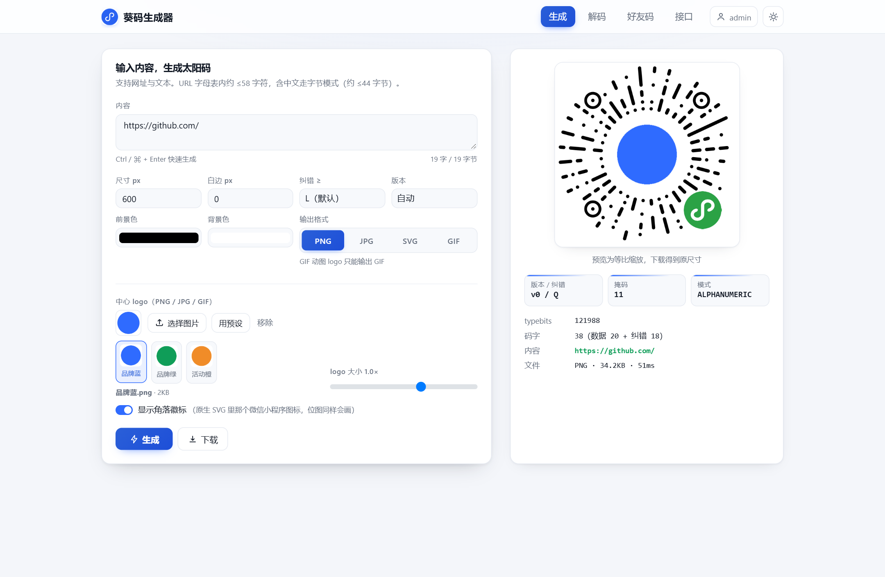
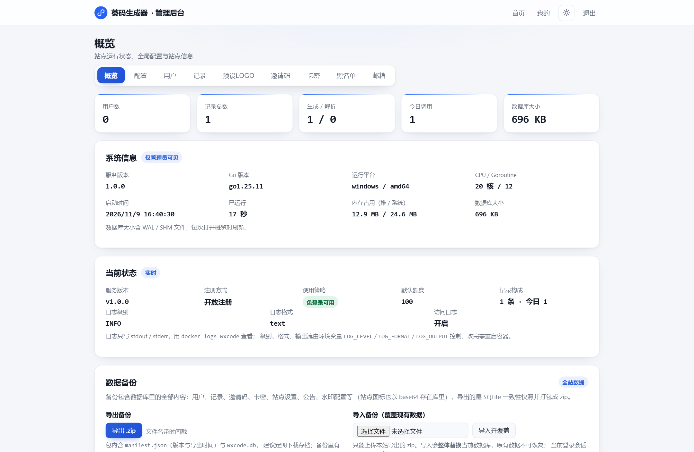
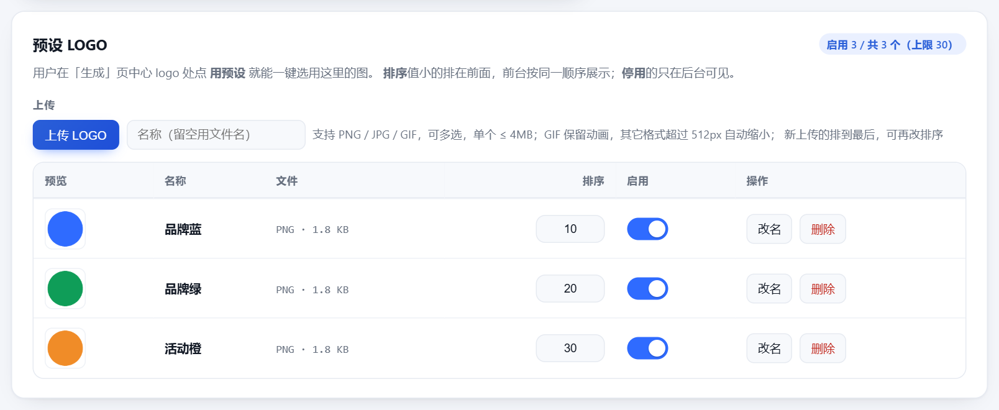

<div align="center">


# 葵码生成器

在线生成与解析微信葵花码（太阳码），支持中心 Logo、动图、水印与批量生成。

<!-- 版本号与仓库根目录的 VERSION 文件保持一致 -->
[](https://wx.xbao.fun)
[](https://github.com/AnglerS888/kuima-generator/releases)
[](https://gitee.com/anglers/kuima-generator)
[](https://github.com/AnglerS888/kuima-generator)


[在线演示](https://wx.xbao.fun) · [快速开始](#快速开始) · [功能](#功能) · [界面预览](#界面预览) · [部署](#部署) · [在线更新](#在线更新) · [常见问题](#常见问题)


<sub>输入链接 → 选中心 Logo → 生成并下载</sub>

</div>

## 在线演示

不想自己部署？直接打开 **<https://wx.xbao.fun>** 试用：

- **前台**：<https://wx.xbao.fun> —— 生成 / 解析 / 好友码 / 接口文档，免登录即可生成，登录后可用批量与更高额度。
- **管理后台**：演示站不对外开放（可看下面的[界面预览](#界面预览)，或自己部署一套）。

演示站跑的就是本仓库的代码，可能随时重建或清空数据，请不要往里放重要内容。

## 快速开始

**Linux 服务器（已装 Docker）**，一条命令搞定：拉源码 → 构建镜像 → 启动容器 → 打印管理员账号密码。
按服务器所在网络选一条：

```bash
# 国外服务器安装
curl -fsSL https://github.com/AnglerS888/kuima-generator/raw/main/bin/deploy.sh -o deploy.sh
bash deploy.sh

# 国内服务器安装
curl -fsSL https://raw.giteeusercontent.com/anglers/kuima-generator/raw/main/bin/deploy.sh -o deploy.sh
bash deploy.sh
```

> 两条命令只是下载脚本的入口不同，脚本内部会自动选线路并把另一条当兜底，**不需要加任何参数**。
> 重复执行即为升级，`--status` 查状态、`--rollback` 回滚。

**或者用 Docker Compose 自己起**（源码已在本机）：

```bash
git clone https://gitee.com/anglers/kuima-generator.git && cd kuima-generator
docker compose up -d --build
```

启动后访问 `http://<服务器IP>:8080/`，管理后台在 `/admin`；Windows / 裸机运行见 [部署](#部署)。

## 项目简介

「葵码生成器」是一个可以自己部署的葵花码（微信太阳码）生成 / 解析服务：
纯 Go 实现、不需要 CGO，编译完就是**一个可执行文件**，数据存在本地 SQLite 文件里，
不用额外装数据库。

页面（生成 / 解码 / 好友码 / 接口文档）用 `go:embed` 打包进了二进制，
所以部署时只要拷一个文件、挂一个数据目录即可。自带账号体系和管理后台，
可以按人分配额度、查看调用记录、维护预设 Logo 和站点配置。

## 功能

- **生成葵花码**：输入网址或任意文字，输出 PNG / JPG / SVG / GIF；尺寸 120~2000，
  白边、前景色 / 背景色、纠错等级、版本、掩码都可以调。
- **中心 Logo**：支持上传 PNG / JPG / GIF；GIF 动图会逐帧替换，生成会动的码。
  后台可以维护一批**预设 Logo**，用户一键选用，支持排序与启用开关。
- **角落徽标 / 文字水印**：徽标可开关或换成自己的图片；水印支持多个方位与平铺、斜铺，
  字号、颜色、透明度可调。
- **解析**：截图、拍照、轻微旋转、带 Logo 的码都能识别，返回码型、版本、掩码、内容。
- **好友码**：上传微信「二维码名片」截图，直接生成对应的好友太阳码。
- **批量生成**：一次提交多条，逐条可以覆盖格式、尺寸、颜色、Logo 等参数。
- **账号与额度**：注册 / 登录 / 验证码 / 邀请码 / 卡密 / API Key，
  可配置「免登录可用」或「必须登录且每次扣额度」。
- **管理后台**：概览、配置、用户、记录、预设 Logo、邀请码、卡密、黑名单、发信设置，
  支持数据备份导出与导入。

## 界面预览

**前台 · 生成页**：左侧参数、右侧实时预览，支持预设 Logo 一键套用。



**后台 · 概览**：运行状态、用户与调用量、系统信息。



**后台 · 预设 Logo**：上传、排序、启用 / 停用与删除。



## 部署

只想先跑起来？见 [快速开始](#快速开始)，下面是不带脚本的详细方式。四种任选其一。启动后访问 `http://localhost:8080/`，管理后台在 `/admin`。

首次启动会创建管理员账号：给了 `ADMIN_PASSWORD` 就用它，没给会**随机生成并打印在启动日志**里。
忘记密码时，带 `ADMIN_RESET_PASSWORD=1` 和一个新的 `ADMIN_PASSWORD` 重启一次即可改回。

常用环境变量：

| 变量 | 说明 |
|---|---|
| `PORT` / `ADDR` | 监听端口（默认 `8080`）/ 直接指定监听地址 |
| `DATA_DIR` | 数据目录，默认 `./data`（SQLite 文件在这里） |
| `DB_PATH` | 直接指定数据库文件路径（可选） |
| `ADMIN_USER` / `ADMIN_PASSWORD` | 首次启动创建的管理员账号 / 密码 |
| `ADMIN_RESET_PASSWORD=1` | 重置已有管理员的密码为 `ADMIN_PASSWORD` |
| `LOG_LEVEL` / `LOG_FORMAT` | 日志级别 `debug/info/warn/error`、格式 `text/json` |

### 一键部署（Linux 服务器）

机器上有 `docker` 就能跑：脚本会拉最新源码 → 构建镜像 → 替换容器 →
**打印管理员账号密码并实际登录验证一次**。两个入口的脚本内容一致，按服务器所在网络选一个即可。

```bash
# 国外服务器安装（GitHub 入口）
curl -fsSL https://github.com/AnglerS888/kuima-generator/raw/main/bin/deploy.sh -o deploy.sh
bash deploy.sh

# 国内服务器安装（Gitee 入口）
curl -fsSL https://raw.giteeusercontent.com/anglers/kuima-generator/raw/main/bin/deploy.sh -o deploy.sh
bash deploy.sh
```

**脚本内部自动选线路，没有任何选线路的参数**：

| 线路 | 仓库 | 适合 |
|---|---|---|
| 线路 1（国内） | `gitee.com/anglers/kuima-generator` | 国内服务器，速度稳定 |
| 线路 2（国外） | `github.com/AnglerS888/kuima-generator` | 海外 / 能直连 GitHub |

启动时会探测两个仓库的响应速度，谁快先走谁、另一个自动兜底；归档下载失败还会自动
改用 `git clone` 把两条线路各试一遍。所以国内服务器会自然落到 Gitee、国外服务器自然落到 GitHub。

```bash
PORT=9090 bash deploy.sh          # 换宿主机端口
bash deploy.sh --status           # 查看状态与管理员密码
bash deploy.sh --rollback         # 回滚到上一次成功部署的镜像
bash deploy.sh --local            # 用当前目录的源码构建（不下载）
```

GitHub 线路默认走 `gh-proxy.org` 加速，想直连用 `GH_MIRROR= bash deploy.sh`；
也可以用 `CODE_URL=` / `GIT_URL=` 指定任意来源。

克隆源码（同样两条线路）：

```bash
git clone https://gitee.com/anglers/kuima-generator.git        # 线路 1：国内
git clone https://github.com/AnglerS888/kuima-generator.git    # 线路 2：国外
```

### Docker（推荐）

```bash
docker build -t wxcode .

docker run -d --name wxcode \
  -p 8080:8080 \
  -v $(pwd)/data:/app/data \
  -e ADMIN_USER=admin \
  -e ADMIN_PASSWORD='换成你自己的密码' \
  wxcode
```

也可以用 compose（数据存在 `wxcode-data` 卷里）：

```bash
docker compose up -d --build
docker compose logs -f wxcode     # 没设密码时，这里能看到随机生成的管理员密码
```

### Linux

```bash
# 1) 编译（需要 Go 1.22+，产物不依赖 libc；版本号取自 VERSION 文件）
CGO_ENABLED=0 go build -ldflags "-X wxcode/internal/config.Version=$(cat VERSION)" -o wxcode ./cmd/wxcode

# 2) 启动
PORT=8080 DATA_DIR=/opt/wxcode/data \
  ADMIN_USER=admin ADMIN_PASSWORD='换成你自己的密码' \
  ./wxcode
```

需要开机自启的话，用 systemd 托管：

```ini
# /etc/systemd/system/wxcode.service
[Unit]
Description=wxcode
After=network.target

[Service]
WorkingDirectory=/opt/wxcode
Environment=PORT=8080
Environment=DATA_DIR=/opt/wxcode/data
ExecStart=/opt/wxcode/wxcode
Restart=always

[Install]
WantedBy=multi-user.target
```

```bash
systemctl daemon-reload && systemctl enable --now wxcode
```

### Windows

```powershell
# 1) 编译（版本号取自 VERSION 文件）
go build -ldflags "-X wxcode/internal/config.Version=$(cat VERSION)" -o wxcode.exe ./cmd/wxcode

# 2) 启动（当前窗口生效）
$env:PORT = "8080"
$env:DATA_DIR = "C:\wxcode\data"
$env:ADMIN_USER = "admin"
$env:ADMIN_PASSWORD = "换成你自己的密码"
.\wxcode.exe
```

也可以直接双击 `wxcode.exe`：默认监听 8080，数据放在程序同级的 `data` 目录，
管理员密码会打印在窗口里。想让配置长期生效，把上面的变量加到「系统属性 → 环境变量」即可。

## 在线更新

后台「概览 → 版本与更新」可以检查并一键升级：

- **版本号**来自仓库根目录的 `VERSION` 文件，构建时注入二进制（Docker / 部署脚本都会自动读取）。
- **检查更新**：依次从 Gitee → GitHub → 加速镜像拉 `VERSION`，与当前版本比对；5 分钟内走缓存。
- **立即更新**：下载当前平台的发布产物，替换程序后自动重启，页面会轮询 `/api/health`，
  读到新版本号后**自动刷新**。

发版时把 `VERSION` 改成新版本号（README 顶部的版本徽章同步改一下），
再按平台命名把产物上传到 Releases 的 latest：

```
wxcode-linux-amd64        wxcode-linux-arm64
wxcode-windows-amd64.exe  wxcode-darwin-arm64 …
```

相关环境变量：

| 变量 | 说明 |
|---|---|
| `UPDATE_DISABLE=1` | 关闭在线更新（只允许走发布流程） |
| `UPDATE_VERSION_URL` | 直接指定远端 VERSION 地址（自建更新源 / 内网） |
| `UPDATE_ASSET_BASE` | 直接指定产物下载目录（如 `https://example.com/dist`） |
| `UPDATE_GITEE_REPO` / `UPDATE_GITHUB_REPO` | 换仓库，默认 `anglers/kuima-generator` / `AnglerS888/kuima-generator` |
| `UPDATE_BRANCH` / `UPDATE_MIRROR` | 分支（默认 `main`）/ GitHub 加速前缀 |

> 容器内更新只对**本次容器**生效，重建容器会回到镜像版本；容器部署建议仍用 `deploy.sh` 升级。
> 旧程序会保留为 `wxcode.exe.old`，确认新版正常后可删除。

## 常见问题

**微信扫出来只显示文字，不跳转？**
葵花码承载的是内容本身，微信只对 `http(s)` 开头的网址做跳转；要扫码打开小程序，
需要微信后台签发的小程序码。

**数据存在哪？怎么备份？**
`DATA_DIR` 下的 `wxcode.db`（SQLite）。停机后拷走该文件即可，也可以在管理后台导出 / 导入整站数据。

**换机器迁移？**
把 `data` 目录和可执行文件一起拷过去，用同样的 `DATA_DIR` 启动，账号、额度、记录、预设 Logo 都会保留。

---

本项目与腾讯、微信无任何关联，仅供学习研究与内部使用。
